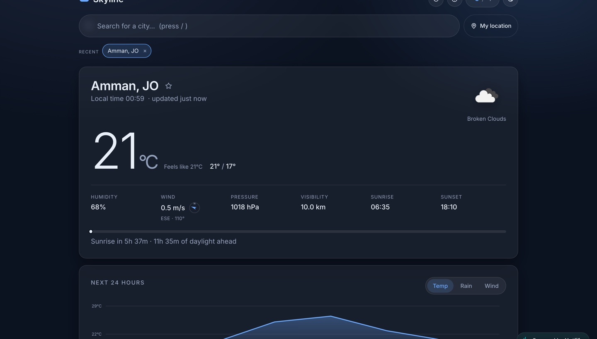

# Skyline — Weather

**Live: [naderabsy-weather.netlify.app](https://naderabsy-weather.netlify.app)**

A weather app built on the OpenWeather API, with an interactive 24-hour chart, air quality and a
5-day forecast that opens up hour by hour. No frameworks and no build step: plain HTML, CSS and
JavaScript, with a small serverless function that keeps the API key off the browser.



## Features

- **Current conditions** — temperature, feels-like, high/low, humidity, pressure, visibility, sunrise and sunset
- **Wind compass** — speed plus a needle and bearing showing the direction it is blowing towards
- **Daylight bar** — where you are between sunrise and sunset, and how much light is left
- **Interactive 24-hour chart** — scrub with a pointer or the arrow keys to read any hour;
  switch between temperature, chance of rain and wind. Scrubbing highlights the matching hour
  in the strip below it.
- **Air quality** — AQI with a five-step scale and a pollutant breakdown (PM2.5, PM10, O₃, NO₂, SO₂, CO)
- **5-day forecast** — daily highs and lows, and each day expands to its hour-by-hour detail
- **City search** — debounced autocomplete via the OpenWeather Geocoding API, navigable by keyboard
- **Geolocation** with a graceful fallback when permission is denied
- **Saved and recent cities** — star a city to pin it; recent lookups are kept automatically
- **°C / °F toggle** and **light/dark theme**, both remembered between visits
- **A backdrop that follows the sky** — the palette shifts with clear, cloud, rain, storm, snow and mist
- **Live local clock**, a freshness stamp, and a refresh every ten minutes
- **Keyboard shortcuts** — <kbd>/</kbd> search, <kbd>u</kbd> units, <kbd>t</kbd> theme,
  <kbd>r</kbd> refresh, <kbd>l</kbd> location, <kbd>1</kbd>–<kbd>3</kbd> chart series,
  <kbd>?</kbd> for the full list

## Stack

JavaScript (no framework, no build step) · hand-rolled SVG charting, no charting library ·
OpenWeather Current, Forecast, Geocoding and Air Pollution APIs · Netlify Functions · deployed on Netlify

## Structure

```
public/
  index.html              The app
  app.css                 All styling, themed with CSS custom properties
  app.js                  Weather data, chart, search, geolocation, units, theme
  login / signup / reset-password, index.js, fireBaseScript.js
                          Firebase account pages; built, but not linked from the live app (see below)
netlify/functions/
  weather.js              Proxy to OpenWeather that adds the API key on the server
netlify.toml              Publish directory, functions and headers
docs/screenshot.jpg       The image above
```

## Keeping the API key secret

The browser never sees the OpenWeather key. The app only calls `/api/weather`, and
`netlify/functions/weather.js` forwards that request to OpenWeather with the key added from the
`OPENWEATHER_API_KEY` environment variable (set under **Netlify → Site configuration →
Environment variables**).

The function only accepts the four endpoints the app uses (current weather, forecast, air
pollution and geocoding) and a fixed set of query parameters. It never forwards a URL it's
given, so it can't be used as an open proxy, and any `appid` a caller sends is ignored.

## Running locally

Because weather requests go through the function, a plain static server isn't enough. Use the
Netlify CLI, which serves the site and the function together:

```bash
npm install -g netlify-cli
OPENWEATHER_API_KEY=your-key netlify dev
```

Then open the address it prints (usually `http://localhost:8888`).

## Accessibility

The chart is reachable by keyboard and announces each hour through a live region, so it is not
a mouse-only feature. The forecast rows are real buttons with `aria-expanded`, the search box is
a proper combobox, and the `[hidden]` attribute is forced to win over class-based `display`
rules so nothing can be left visible after it is dismissed. Motion respects
`prefers-reduced-motion`.

## Accounts (switched off)

Sign-up, log-in, Google sign-in, password reset and email verification are built with Firebase
Authentication and Firestore, in the account pages listed above. They're switched off on the
live site because Firebase only allows sign-in from domains on its authorised list, and this
deployment's domain hasn't been added yet. To turn them back on, add the domain under
**Firebase Console → Authentication → Settings → Authorized domains**, then restore the account
links and the `index.js` / `fireBaseScript.js` scripts in `public/index.html`.

The Firebase config values in `public/fireBaseScript.js` are meant to be public; Firebase security
comes from its rules, not from hiding that key.

---

Built by [Nader Absy](https://naderabsy.com)
